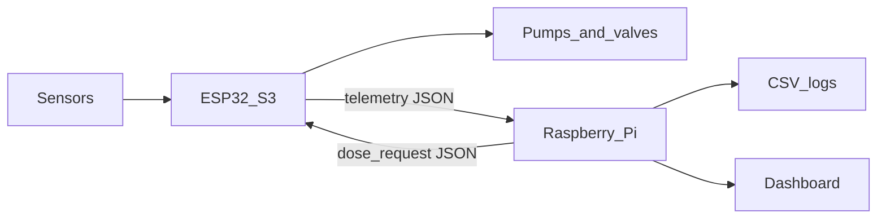

# Automated Basil NFT Hydroponic System

Embedded control, IoT monitoring, and optional ANFIS dosing for a basil crop grown with Nutrient Film Technique (NFT).

This repository is organized by milestones. Milestone 1 is documentation, and it is complete. Firmware and dashboard code come in later milestones.

## What the system does

A mixing tank holds nutrient solution. A circulation pump sends a thin film of that solution through NFT channels where basil grows, then the solution returns to the tank.

The controller keeps the tank inside a safe range for basil:

- pH near the crop target
- electrical conductivity (EC) near the crop target
- enough water in the tank
- flow through the channels

Dosing pumps add Solution A, Solution B, pH Up, or pH Down in short timed pulses. An optional fresh-water pump can dilute the tank. Optional valves can hold water as a backup. Those optional parts are not required for the first working system.

## Two controllers, one safety boundary

| Board | Responsibility |
| --- | --- |
| ESP32-S3 | Read sensors, run safety checks, drive pumps and valves, stop every pump on a deadline, exchange JSON with the Raspberry Pi |
| Raspberry Pi | Log data, show a simple dashboard, and later decide dose requests (fixed rules, PID, fuzzy logic, or ANFIS) |

The Raspberry Pi never drives a pump pin. It sends a dose **request**. The ESP32-S3 accepts or rejects that request. If the USB cable is unplugged, local safety on the ESP32-S3 still stops pumps on time.



## Folder map

```text
hydroponic-system/
|-- esp32_firmware/          planned ESP32-S3 firmware (not written yet)
|-- raspberry_pi/            planned Pi programs (not written yet)
|   |-- dosing_methods/      fixed rules, PID, fuzzy logic, ANFIS
|   |-- data/                CSV logs, created when logging starts
|-- docs/                    architecture, tables, protocol, milestones, tests
|-- README.md                this file
```

Planned source files are listed in [esp32_firmware/README.md](esp32_firmware/README.md) and [raspberry_pi/README.md](raspberry_pi/README.md). They are not in the repository yet.

## Where to read next

| Document | Contents |
| --- | --- |
| [docs/system_architecture.md](docs/system_architecture.md) | Tanks, boards, and data flow |
| [docs/sensors_table.md](docs/sensors_table.md) | Sensor list and what a bad reading means |
| [docs/actuators_table.md](docs/actuators_table.md) | Pumps, valves, and maximum run times |
| [docs/safety_rules.md](docs/safety_rules.md) | Rules that stay inside the ESP32-S3 |
| [docs/communication_protocol.md](docs/communication_protocol.md) | USB serial JSON messages |
| [docs/milestones.md](docs/milestones.md) | Implementation order |
| [docs/testing_plan.md](docs/testing_plan.md) | How each milestone is checked |

## Current status

| Milestone | Status |
| --- | --- |
| 1. Documentation | Done |
| 2–8. Firmware, link, dashboard, dosing | Not started |

See [docs/milestones.md](docs/milestones.md) for the full sequence. ANFIS is optional. The core system is complete when fixed-rule dosing works and the ESP32-S3 still enforces every safety rule.
