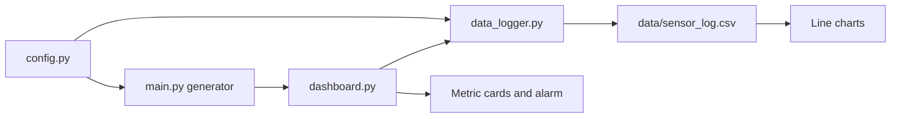

# Fake-data Streamlit dashboard

Local fake-data dashboard only. The pipeline is fake sensor data, then the Streamlit page, then the CSV log, with metric cards, an alarm banner, and line charts.

Do not add serial communication, ESP32 code, Raspberry Pi GPIO, dosing logic, ANFIS, MQTT, or hardware libraries. Do not rewrite [milestones.md](milestones.md).

Allowed libraries only: Streamlit, pandas, pathlib, random, time, and datetime. CSV read and write go through pandas. Paths go through pathlib. No `csv`, `subprocess`, `os`, `json`, serial, GPIO, or MQTT imports.

## How it runs

One Streamlit process. Each cycle builds one fake reading, appends it to CSV, draws the page, waits 2 seconds, then reruns.

Start from `raspberry_pi/`:

- `pip install -r requirements.txt`
- `streamlit run dashboard.py`

## Files

- [../raspberry_pi/config.py](../raspberry_pi/config.py) — interval (2 s), CSV path, column order, normal bands, and alarm thresholds. Field names stay as in the prompt example (`ec_tds`, `water_level`, and so on).
- [../raspberry_pi/main.py](../raspberry_pi/main.py) — `generate_reading(previous)` using `random` and `datetime` only. No launcher and no hardware.
- [../raspberry_pi/data_logger.py](../raspberry_pi/data_logger.py) — pandas appends one row and loads recent rows. pathlib creates the `data/` folder and the CSV header if they are missing.
- [../raspberry_pi/dashboard.py](../raspberry_pi/dashboard.py) — Streamlit UI only. `time.sleep(2)` then `st.rerun()`.
- [../raspberry_pi/data/sensor_log.csv](../raspberry_pi/data/sensor_log.csv) — header row only; readings are added while the app runs.
- [../raspberry_pi/requirements.txt](../raspberry_pi/requirements.txt) — `streamlit` and `pandas` only.
- Short "how to run" note in [../raspberry_pi/README.md](../raspberry_pi/README.md).

## Reading shape

The example reading, plus the two statuses the dashboard must show:

- `timestamp` as `YYYY-MM-DD HH:MM:SS`
- `ph`, `ec_tds` (about 850, TDS-style), `water_level` (percent), `water_temperature`, `flow_rate`, `air_temperature`, `humidity`, `light_intensity`
- `system_status`: `NORMAL`, `WARNING`, or `ALARM`
- `pump_status`: `ON` or `OFF` (circulation stand-in: on when level and flow look safe)
- `valve_status`: `OPEN` (normal NFT path; valves are not controlled here)
- `alarm`: `NONE`, or a short label such as `LOW_WATER`, `HIGH_PH`, `LOW_PH`, `HIGH_EC`, `LOW_EC`

Generation is a small random walk around the example values, clamped to sane limits, held in `st.session_state` so the charts move smoothly. Every few samples, one value is pushed outside its band so the alarm banner is visible. Status fields are derived from the numbers, not picked independently.

## Dashboard

- Metric cards for the eight sensor values plus system, pump, and valve status.
- A banner: green when `alarm` is `NONE`, red when it is not, with `system_status` and the alarm text.
- Line charts of the numeric columns from the last ~60 CSV rows (about two minutes). Status columns are not charted.
- Each new reading is written before the charts reload, so the page matches the latest CSV row.

Code stays short, with comments on why a threshold or field exists, not on every line.
