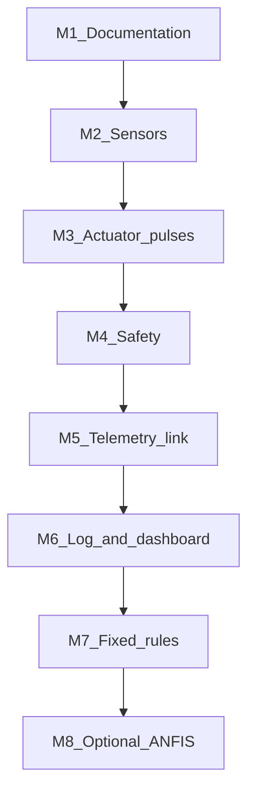

# Milestone plan

The project is built in small steps. Each milestone has a goal, the files it will add later, and a clear done-when check. Do not start a milestone until the one before it meets its done-when line.

Documentation is milestone 1 and is the only milestone written in the repository today. Later milestones add code. They do not change the safety boundary: the ESP32-S3 drives pumps, and the Raspberry Pi only sends requests.

ANFIS is milestone 8 and is optional. The core system is finished at the end of milestone 7.

## Milestone 1 — Documentation

**Goal.** Describe the system so later code has a fixed architecture, sensor list, actuator list, safety rules, and message format.

**Files.** This repository’s Markdown files under `docs/`, plus the root README and the two module READMEs.

**Done when.** A reader can answer where each sensor and pump connects, which board may turn a pump on, and what a dose request looks like.

## Milestone 2 — Sensor reading on the bench

**Goal.** The ESP32-S3 reads every required sensor and prints calibrated values on USB serial. No pumps run in this milestone.

**Files later.**

- `esp32_firmware/main.cpp`
- `esp32_firmware/sensors.h`
- `esp32_firmware/sensors.cpp`

**Done when.**

- pH matches buffer solutions closely enough for a class demo (within about 0.1 pH after calibration).
- EC matches a calibration standard at a known temperature.
- DS18B20, level, flow, and the air sensor all change when the physical condition changes.
- A disconnected probe is reported as invalid, not as a normal zero.
- The optional BH1750 is either reading lux or clearly marked absent.

## Milestone 3 — Timed actuator pulses

**Goal.** Each dosing pump can run for a requested time and always stops at a deadline stored on the ESP32-S3. Use water, not nutrient, during tests.

**Files later.**

- `esp32_firmware/actuators.h`
- `esp32_firmware/actuators.cpp`

**Done when.**

- Solution A, Solution B, pH Up, and pH Down each run and stop at the commanded time.
- A pulse longer than the maximum in [safety_rules.md](safety_rules.md) does not start.
- Unplugging USB during a pulse still stops the pump at the deadline.
- Circulation can be turned on and off from the ESP32-S3 local logic in a bench test (level input simulated with a switch).

## Milestone 4 — Safety interlocks

**Goal.** Implement [safety_rules.md](safety_rules.md) on the ESP32-S3 before the Pi is allowed to request doses.

**Files later.**

- `esp32_firmware/safety.h`
- `esp32_firmware/safety.cpp`

**Done when.** The tests in the safety section of [testing_plan.md](testing_plan.md) pass: low level, invalid sensor, A with B, pH Up with pH Down, and the 10 second gap.

## Milestone 5 — USB serial JSON, telemetry only

**Goal.** The ESP32-S3 sends `telemetry` lines. The Raspberry Pi reads them. The Pi does not send dose requests yet.

**Files later.**

- `esp32_firmware/communication.h`
- `esp32_firmware/communication.cpp`
- `raspberry_pi/serial_reader.py`
- `raspberry_pi/config.py`

**Done when.** A Pi program prints one parsed telemetry record per second, including `null` for an invalid sensor, and ignores a deliberately corrupt line without crashing.

## Milestone 6 — Logging and a read-only dashboard

**Goal.** Store telemetry and show the latest values. Still no dosing from the Pi.

**Files later.**

- `raspberry_pi/main.py`
- `raspberry_pi/data_logger.py`
- `raspberry_pi/dashboard.py`
- `raspberry_pi/data/sensor_log.csv` (created at runtime)

**Done when.** New rows appear in `sensor_log.csv` while the system runs, the dashboard matches the latest row, and stopping the Pi does not change ESP32-S3 pump behavior.

## Milestone 7 — Fixed-rule dose requests

**Goal.** The Pi sends `dose_request` messages from simple pH and EC thresholds. The ESP32-S3 returns `dose_result` and runs a pump only when safety allows.

**Files later.**

- `raspberry_pi/dosing_methods/base.py`
- `raspberry_pi/dosing_methods/fixed_rules.py`
- `raspberry_pi/data/dosing_dataset.csv` (created at runtime)

**Done when.**

- A low pH produces a pH Up request, and a high pH produces a pH Down request, using targets from `config.py`.
- A low EC produces separate Solution A and Solution B requests with a gap.
- Every rejection reason in [communication_protocol.md](communication_protocol.md) can be produced on purpose and appears in the dosing log.
- The ESP32-S3 still refuses unsafe requests while the dashboard is open.

This milestone completes the core graduation system.

## Milestone 8 — Optional dosing methods

**Goal.** Add PID, fuzzy logic, or ANFIS behind the same `dose_request` message. The ESP32-S3 safety code stays unchanged.

**Files later.**

- `raspberry_pi/dosing_methods/pid_control.py`
- `raspberry_pi/dosing_methods/fuzzy_logic.py`
- `raspberry_pi/dosing_methods/anfis_model.py`

**Done when.** `config.py` can select one method, the selected method emits the same request shape as fixed rules, and an unsafe request from that method is still rejected by the ESP32-S3.

ANFIS additionally needs enough rows in `dosing_dataset.csv` before it is trained. Until that dataset exists, fixed rules remain the active method.

## Suggested order of work

Milestones 2, 3, and 4 can be demonstrated with the ESP32-S3 alone. The Raspberry Pi joins at milestone 5.
