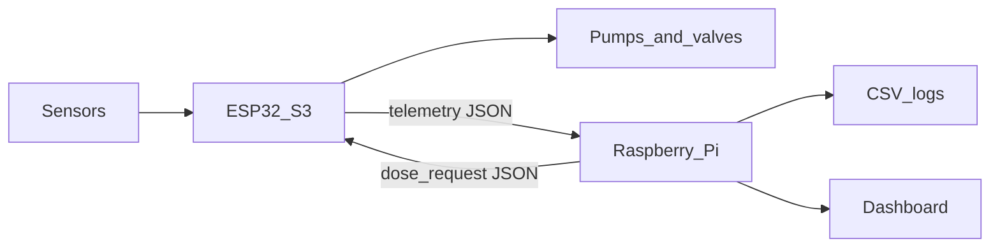

# System architecture

This document describes the basil NFT hydroponic system: the tanks and channels, the two boards, and how data and commands move between them.

## Physical layout

One main mixing tank holds the nutrient solution. A circulation pump draws from that tank and sends a thin film through the NFT channels. The film returns to the same tank.

Five source containers feed the tank through dosing pumps:

| Container | Pump | Required |
| --- | --- | --- |
| Solution A | Solution A dosing pump | Yes |
| Solution B | Solution B dosing pump | Yes |
| pH Up | pH Up dosing pump | Yes |
| pH Down | pH Down dosing pump | Yes |
| Fresh water | Fresh-water pump | Optional |

Solution A and Solution B are concentrated stocks. They are dosed separately so the concentrates do not meet in a pump line. pH Up and pH Down are also dosed separately.

Optional valves can retain water as a backup if the main path needs to be isolated. They are not part of the first control loop.

## Boards

### ESP32-S3

The ESP32-S3 is the embedded controller. It sits next to the sensors and the pumps.

It is responsible for:

- sensor reading
- safety checks
- actuator control
- pump stop deadlines
- USB serial communication with the Raspberry Pi

Every pump output is wired to the ESP32-S3. No pump pin is wired to the Raspberry Pi.

### Raspberry Pi

The Raspberry Pi is the monitoring and decision computer. It is responsible for:

- a simple dashboard
- data logging
- an optional ANFIS model later
- receiving sensor data from the ESP32-S3
- sending dosing commands back to the ESP32-S3

A dosing command is a request. The ESP32-S3 may refuse it. The Pi records that refusal and does not drive the pump itself.

## Data flow

1. Sensors report pH, EC, temperatures, humidity, level, flow, and optional light level to the ESP32-S3.
2. The ESP32-S3 checks safety, then updates pump outputs. A running pump always has a stop time stored on the ESP32-S3.
3. The ESP32-S3 sends one JSON telemetry line over USB serial.
4. The Raspberry Pi appends that line to a log and shows it on the dashboard.
5. When a dosing method is enabled, the Pi may send one `dose_request` line.
6. The ESP32-S3 answers with `dose_result`. If the request is accepted, the ESP32-S3 starts the pump and arms the stop deadline.

## What stays local

These actions never leave the ESP32-S3:

- turning a pump on or off
- enforcing the maximum run time
- blocking a dose when the tank level is low
- blocking a dose when pH or EC readings are invalid
- blocking Solution A and Solution B at the same time
- blocking pH Up and pH Down at the same time

If USB serial disconnects, telemetry stops and no new dose request can arrive. Pumps that are already running still stop when their deadline is reached. Circulation continues only while the local level and flow checks pass. The full rule list is in [safety_rules.md](safety_rules.md).

## Software layout

Firmware modules on the ESP32-S3 are planned as `sensors`, `actuators`, `safety`, and `communication`, called from `main.cpp`. See [../esp32_firmware/README.md](../esp32_firmware/README.md).

Pi modules are planned as a serial reader, a logger, a dashboard, and one active dosing method. See [../raspberry_pi/README.md](../raspberry_pi/README.md).

Message fields are defined in [communication_protocol.md](communication_protocol.md).

## Optional parts

The first working system needs the mixing tank, NFT circulation, Solution A, Solution B, pH Up, pH Down, and the required sensors in [sensors_table.md](sensors_table.md).

These parts can be added later without changing the safety boundary:

- fresh-water pump
- backup retention valves
- BH1750 light sensor
- air sensor choice: BME280 or AHT20
- dosing methods beyond fixed rules: PID, fuzzy logic, and ANFIS

ANFIS uses the logged dosing dataset. It is a later option. The tank remains safe if that model is never installed, because dose requests still pass through the ESP32-S3.
